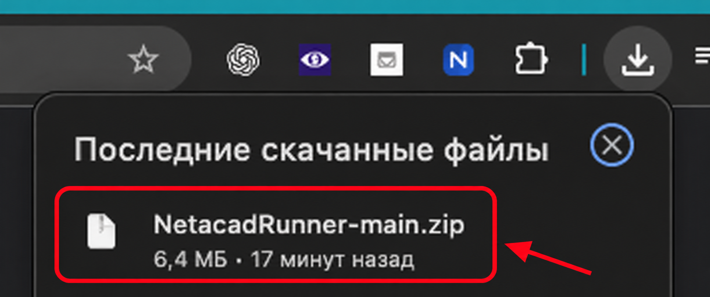
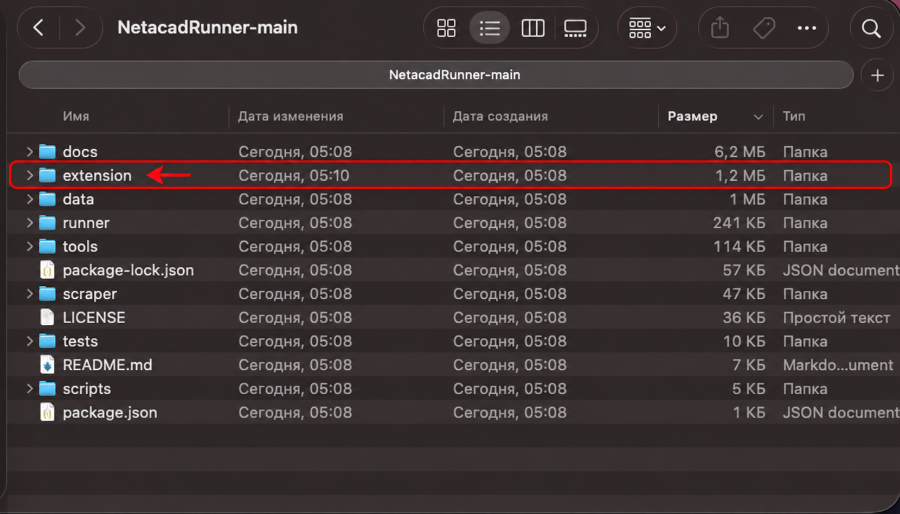
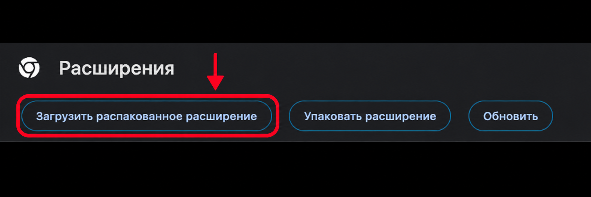
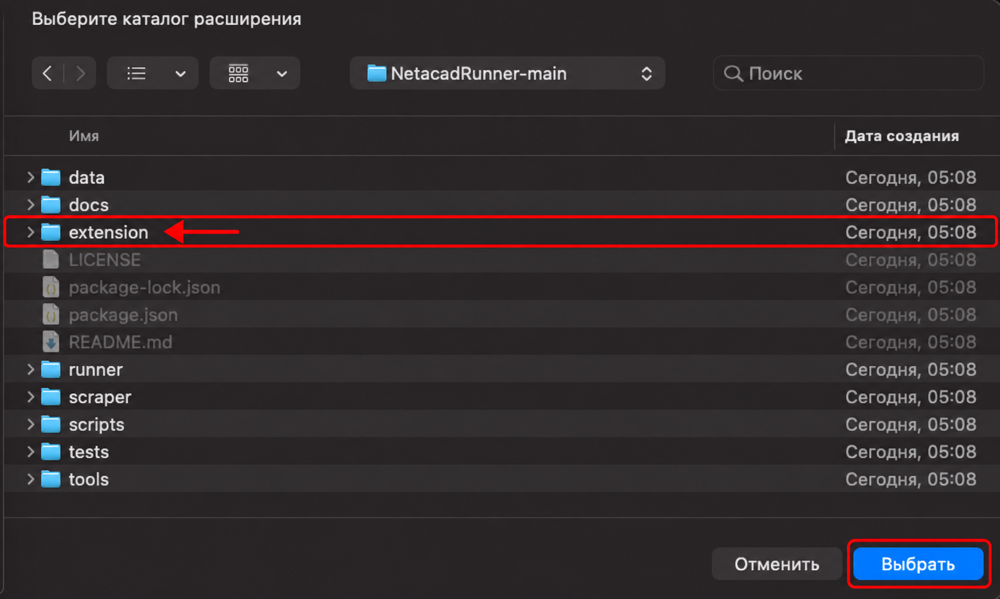
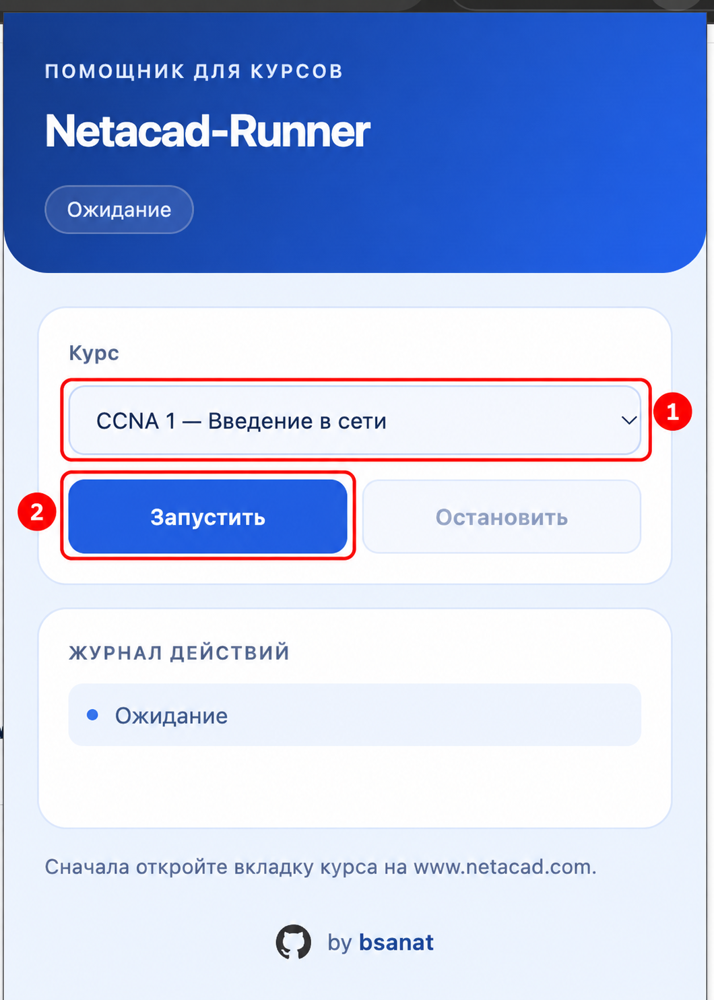
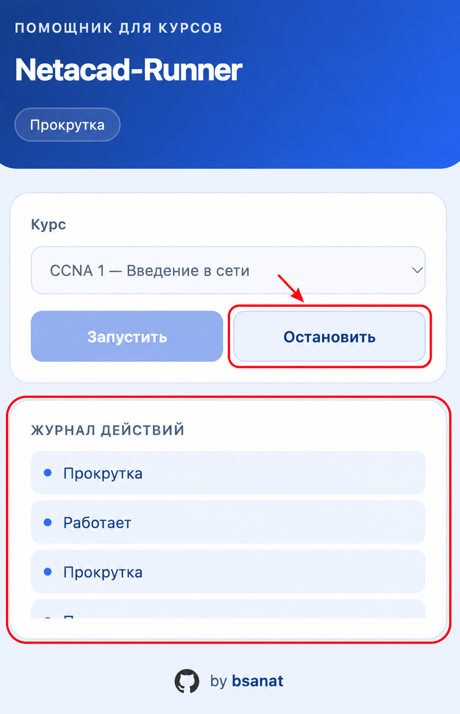

<!--
    netacad-automation
    Copyright (C) 2026 Saurabh Kumar Yadav

    This program is free software: you can redistribute it and/or modify
    it under the terms of the GNU General Public License as published by
    the Free Software Foundation, either version 3 of the License, or
    (at your option) any later version.

    This program is distributed in the hope that it will be useful,
    but WITHOUT ANY WARRANTY; without even the implied warranty of
    MERCHANTABILITY or FITNESS FOR A PARTICULAR PURPOSE.  See the
    GNU General Public License for more details.

    You should have received a copy of the GNU General Public License
    along with this program.  If not, see <https://www.gnu.org/licenses/>.
-->

<div align="center">
  
  <h1>Netacad-Runner</h1>
  <p><strong>Помощник для курсов NetAcad с понятным русским интерфейсом</strong></p>
  <p>Версия 1.0.3 · Google Chrome · Manifest V3</p>
  <p>
    <a href="https://github.com/bsanat/NetacadRunner/archive/refs/heads/main.zip"><strong>Скачать ZIP</strong></a>
    &nbsp;·&nbsp;
    <a href="#установка">Установка</a>
    &nbsp;·&nbsp;
    <a href="#запуск">Как пользоваться</a>
    &nbsp;·&nbsp;
    <a href="#если-что-то-не-работает">Помощь</a>
  </p>
  <p>by <a href="https://github.com/bsanat"><strong>bsanat</strong></a></p>
</div>

---

Netacad-Runner помогает прокручивать материалы и переходить между страницами курса на [NetAcad](https://www.netacad.com), работать с видео и отвечать на поддерживаемые задания с помощью встроенных баз ответов. Текущее действие видно в журнале; обработку можно остановить кнопкой.

**Для установки достаточно скачать архив и выбрать папку `extension`. Node.js, терминал и сборка не нужны.**

## Установка

Ниже — шесть шагов от скачивания до запуска. На скриншотах нужные элементы выделены **красным**. Показан macOS; в Windows выбирайте те же папки и кнопки Chrome.

### 1. Скачайте архив

Нажмите **[Скачать ZIP](https://github.com/bsanat/NetacadRunner/archive/refs/heads/main.zip)** или откройте [страницу проекта](https://github.com/bsanat/NetacadRunner) и выберите **Code → Download ZIP**.

Дождитесь загрузки файла `NetacadRunner-main.zip`.



### 2. Распакуйте и найдите extension

Распакуйте архив: на macOS откройте ZIP двойным щелчком, в Windows нажмите правой кнопкой → **Извлечь всё**. Внутри папки `NetacadRunner-main` найдите **`extension`** — она выделена на скриншоте.



> **Важно:** Chrome нужна именно папка `extension`, а не ZIP и не вся папка `NetacadRunner-main`. Сохраните распакованную папку на компьютере: из неё Chrome загружает расширение.

### 3. Откройте расширения Chrome

Скопируйте в адресную строку Chrome и нажмите Enter:

```text
chrome://extensions
```

Включите **Режим разработчика** в правом верхнем углу. Если установлена прежняя версия Netacad-Runner или NetAcad AutoRunner, отключите её.

Нажмите **Загрузить распакованное расширение**:



### 4. Выберите папку extension

В открывшемся окне перейдите в распакованную папку `NetacadRunner-main`, выделите **`extension`** и нажмите **Выбрать**. В Windows кнопка может называться **Выбор папки**.



После установки на странице расширений появится карточка **Netacad-Runner**. Чтобы значок **N** был под рукой, откройте меню расширений Chrome (значок пазла) и закрепите Netacad-Runner.

## Запуск

### 5. Откройте курс и нажмите «Запустить»

1. Войдите в свой аккаунт на [www.netacad.com](https://www.netacad.com) и откройте **содержимое нужного курса**.
2. Обновите вкладку курса: **⌘R** на macOS или **Ctrl+R** в Windows. Это особенно важно после установки новой версии.
3. На этой вкладке нажмите значок **N** в панели Chrome.
4. В поле **Курс** выберите базу, соответствующую открытому курсу — **①** на скриншоте.
5. Нажмите **Запустить** — **②**.



### 6. Следите за журналом и останавливайте при необходимости

В **Журнале действий** появляются текущие состояния: например, **Работает**, **Прокрутка**, **Обработка видео** или **Переход далее**. Окно расширения можно закрыть — обработка продолжится во вкладке курса.

Чтобы остановить Runner, сделайте вкладку курса активной, снова откройте расширение и нажмите **Остановить**.



## Поддерживаемые курсы

| Выбор в расширении | Курс |
| --- | --- |
| CCNA 1 | Введение в сети |
| CCNA 2 | Коммутация, маршрутизация и Wi-Fi |
| CCNA 3 | Корпоративные сети и безопасность |
| Основы Python 1 | Python Essentials 1 |
| Основы Python 2 | Python Essentials 2 |
| Основы анализа данных | Data Analytics Essentials |
| Введение в кибербезопасность | Introduction to Cybersecurity |

Выбирайте базу для своего курса. При смене базы расширение может перезагрузить вкладку. Ответы отправляются от имени текущего аккаунта; встроенные базы могут содержать ошибки и не гарантируют результат.

## Как обрабатывается видео

Runner нажимает **Play** на обложке, ждёт загрузки плеера, запускает ролик и перематывает на последние **2,5 секунды**. Переход дальше происходит после настоящего завершения видео. Время загрузки зависит от соединения и плеера.

Если браузер блокирует автоматический запуск, нажмите **Play** вручную. Ролик, который не загрузился или не запустился, не считается завершённым.

## Если что-то не работает

| Что видно | Что сделать |
| --- | --- |
| Chrome не устанавливает расширение | Сначала распакуйте ZIP, затем выберите вложенную папку `extension`, в которой лежит `manifest.json`. |
| Значка N нет в панели | Откройте меню расширений Chrome (пазл) и закрепите Netacad-Runner. |
| «Откройте вкладку NetAcad» | Переключитесь на вкладку с содержимым курса, затем откройте расширение заново. |
| «Ожидание видео» | Дождитесь загрузки плеера и длительности ролика. |
| «Нажмите Play в плеере» | Нажмите Play в самом курсе. |
| «Видео не загрузилось» | Проверьте, запускается ли оно вручную. При необходимости обновите вкладку курса и запустите Runner заново. |
| «Требуется ваше действие» | Пройдите этот элемент самостоятельно. Задания Packet Tracer расширение не выполняет. |
| После обновления осталось старое поведение | Обновите расширение на `chrome://extensions`, затем **саму вкладку курса** и снова нажмите «Запустить». |

Если проблема повторяется, [создайте Issue](https://github.com/bsanat/NetacadRunner/issues) и укажите версию расширения, название курса, номер урока и последнее состояние в журнале.

## Обновление

1. Нажмите **Остановить** на вкладке курса.
2. Скачайте свежий ZIP и распакуйте его.
3. Замените содержимое установленной папки `extension` файлами из новой версии.
4. Откройте `chrome://extensions` и нажмите значок обновления **на карточке Netacad-Runner**.
5. Обновите вкладку NetAcad и снова нажмите **Запустить**.

Если установочная папка была перемещена или удалена, загрузите новую папку `extension` через **Загрузить распакованное расширение**. Оставьте включённой только одну версию Runner.

<details>
<summary><strong>Для разработчиков: сборка и структура проекта</strong></summary>

Для обычной установки этот раздел можно пропустить: готовые файлы уже включены в репозиторий.

Из корня проекта:

```bash
npm ci
npm run build
npm test
```

`npm run build` собирает `runner/auto-runner.js`, `extension/runner.js` и копирует базы в `extension/data`. Для сборки только расширения используйте `npm run build:extension`. Эти команды не устанавливают расширение и не запускают курс.

| Папка | Содержимое |
| --- | --- |
| `extension` | Готовое расширение Chrome, интерфейс и служебный код |
| `runner/src` | Исходный код обработки материалов, видео и навигации |
| `data` | Базы ответов |
| `tests` | Автоматические проверки |
| `docs/images` | Скриншоты инструкции с красными отметками |

Разрешения расширения описаны в [extension/README.md](extension/README.md#разрешения).

</details>

## Авторство и лицензия

Основано на [netacad-automation](https://github.com/yadavsaurabh1/netacad-automation) — Copyright (C) 2026 **Saurabh Kumar Yadav**. Исходные уведомления об авторстве сохранены.

Русский интерфейс, оформление и поддержка изменённой версии Netacad-Runner — **[bsanat](https://github.com/bsanat)**.

Лицензия — **[GNU GPL v3 или более поздняя версия](LICENSE)**. При распространении сохраняйте уведомления об авторстве и лицензию и предоставляйте соответствующий исходный код согласно GPL.

---

<p align="center">by <a href="https://github.com/bsanat"><strong>bsanat</strong></a></p>
